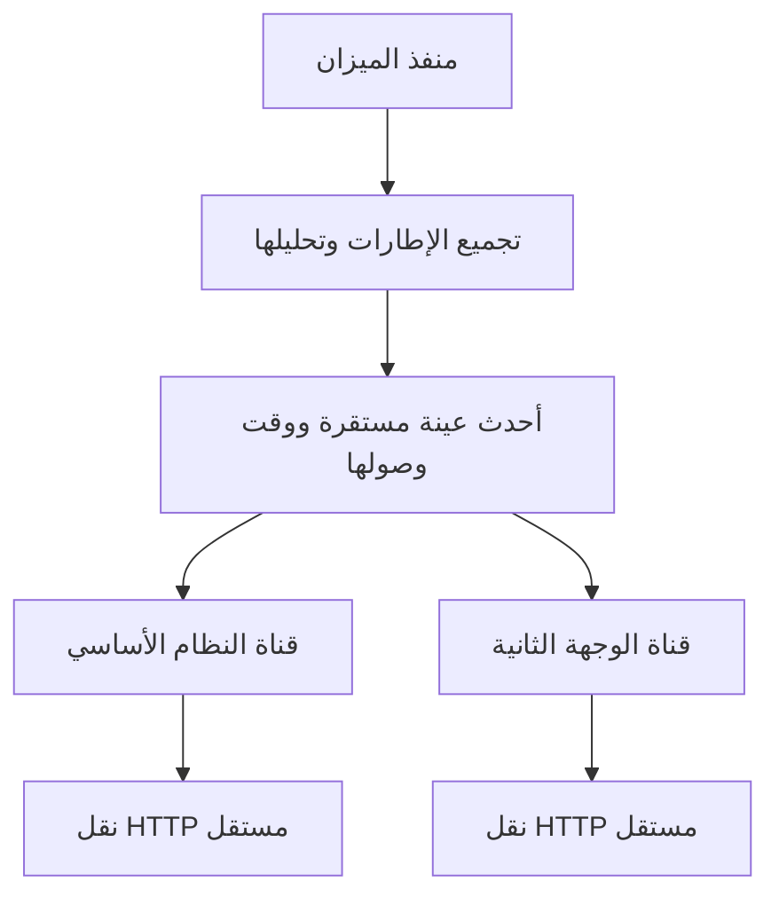

# المعمارية ومسؤوليات المكونات

## قرار الهيكلة

المشروع تطبيق WinForms واحد مع مشروع اختبارات مستقل. الفصول الوظيفية موزعة إلى مجلدات منطقية، لكنها ليست حزمًا مستقلة أو خدمات شبكة. هذا يحافظ على بساطة تثبيت البرنامج وعلى التوافق مع أجهزة Windows الموجودة. لم ننقل المشروع إلى .NET حديث يتطلب Runtime جديدًا على جهاز الشركة.

الـnamespace القديم `WeighbridgeBridge` مقصود. الاسم الظاهر والملف التنفيذي هما «قبان الغد» و`QabanAlGhad.exe`، بينما يبقى مجلد البيانات وقفل التشغيل وأسماء الحقول كما كانت. تغيير الاسم التسويقي لا يستدعي كسر توافق الإعدادات.

## اتجاه تدفق البيانات

المنفذ يُقرأ من حلقة WinForms كل 100ms. لا تعني هذه القيمة أن الميزان يجب أن ينتج قراءة كل 100ms؛ البرنامج يستقبل تدفق الجهاز ويجمّع الأجزاء حتى نهاية CR/LF. لا يحوّل جزء رسالة إلى وزن قبل اكتمالها.

## طبقة المجال

`Protocol` يفسر القيم فقط، ولا يفتح المنفذ ولا يعرف عناوين الخوادم. `Frames` يحتفظ بجزء الإطار الناقص ويعيد نتيجة أحدث إطار مكتمل. إذا كان الإطار الأحدث غير صالح أو غير مستقر، لا يستعمل وزنًا صالحًا أقدم منه من الدفعة نفسها.

`ReadingPolicy` يستخدم ساعة رتيبة لحداثة القراءة والمهلة. أما `sampledAt` المرسل للخادم فيستخدم UTC ليتفق مع واجهة الموقع. تغيير ساعة الجهاز لا يدخل مباشرة في حساب عمر القراءة المحلي، لكنه قد يجعل الموقع يرفض توقيت العينة.

`DeliverySchedule` يقرر موعد بدء المحاولة التالية. توجد فيه أدوات قديمة للتأكيد وإعادة المحاولة ما زالت مغطاة باختبارات؛ المسار الفعلي لـ`OutputChannel.Pump` يستخدم الجدولة الدورية، ولا يستخدم شرط «أرسل عند تغير الوزن فقط».

## طبقة التطبيق والنقل

لكل `OutputChannel` حالة `Busy` و`Ready` وطلب `active` وعداد `generation` وجدول مستقل. عند الإيقاف تُلغى الطلبات، ويمنع العداد ردود الطلبات السابقة من تحديث الحالة الجديدة. لا توجد قائمة عينات ولا إعادة إرسال تاريخية.

`ApiTransport` مسؤول عن التسلسل الشبكي فقط: إنشاء POST، إضافة Bearer عند وجوده، ضبط TLS 1.2، منع التحويل التلقائي إلى login، كتابة الجسم، ثم قراءة الرد ضمن حد معين. `ResponseRules` يفسر الرد بعد النقل ولا يقبل مجرد وجود كلمة success في نص عشوائي.

## الواجهة

الواجهة تعرض الوزن وحالة الميزان وحالة الإرسال فقط، مع تبويبات الوزن والإعدادات والسجل. الوجهة الثانية غير ظاهرة. لا توجد مساعدة مطولة أو حقول تخص المرتجعات. إزالة «رد الخادم» تخص العرض فقط؛ لا تلغي التحقق من الرد أو تدوين الأخطاء.

`MainForm` مقسّم إلى partial files لتقليل تداخل التغييرات. هذه خطوة فصل ملفات، وليست ادعاء بأن منطق WinForms أصبح منفصلًا بالكامل. ما زال فتح `SerialPort` وتحديث الحقول يتمان من `MainForm.Weighing.cs`. يمكن استخراج جلسة قراءة مستقلة لاحقًا بتغيير واختبارات مخصصة، دون دمجه عشوائيًا مع تطوير Updater.

## ثوابت التوافق

| الثابت | لماذا يبقى ثابتًا؟ |
| --- | --- |
| `%LOCALAPPDATA%\WeighbridgeBridge` | العثور على إعدادات الجهاز الموجودة |
| `WeighbridgeBridge.SingleInstance` | منع نسختين من فتح نفس المنفذ |
| أسماء حقول `Settings` | توافق JSON مع الإصدارات المثبتة |
| entropy في `LocalSecrets` | فتح الرموز المشفرة سابقًا |
| `String.Split(char[])` الصريح | منع MissingMethodException الذي ظهر في Windows |
| أحدث إطار هو المرجع | منع إرسال وزن سابق بعد إطار غير مستقر |

## حدود الاختبار

الاختبارات المحلية تثبت قواعد التحليل والجدولة والعزل والتشفير المحلي وشكل HTTP. لا تثبت دعم كل تعريف USB/Serial، ولا زمن استجابة خادم الشركة، ولا نجاح حفظ وزن إنتاجي. يلزم تحقق Windows ومراقبة قراءة حقيقية قبل اعتماد إصدار جديد.
